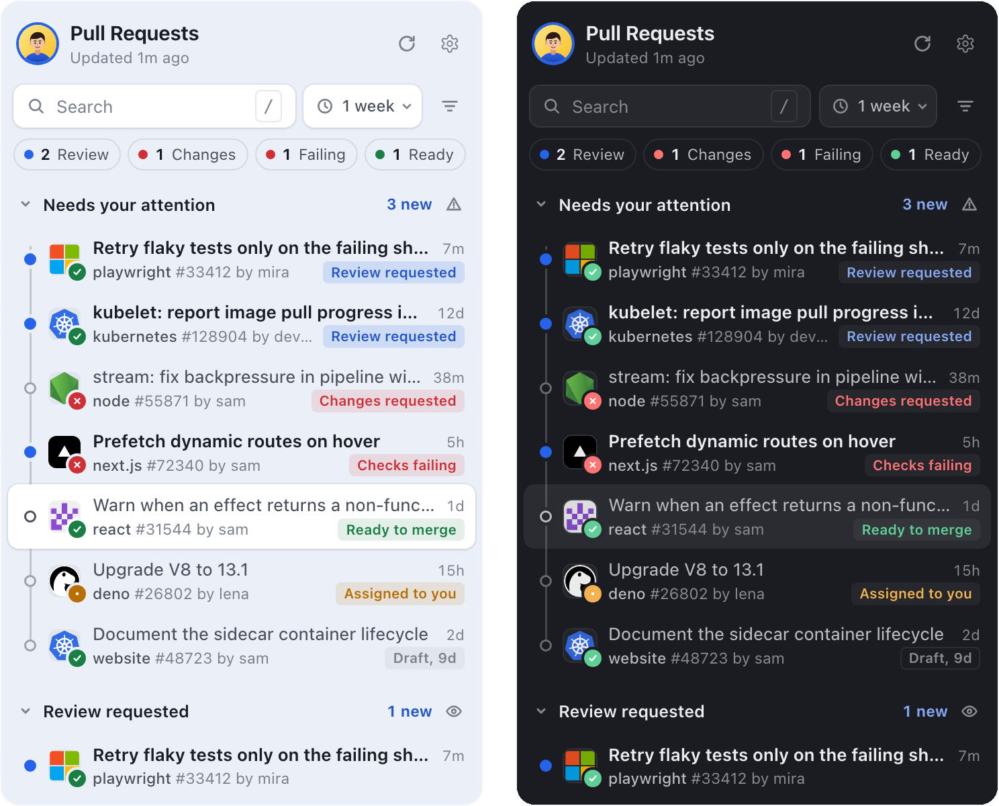
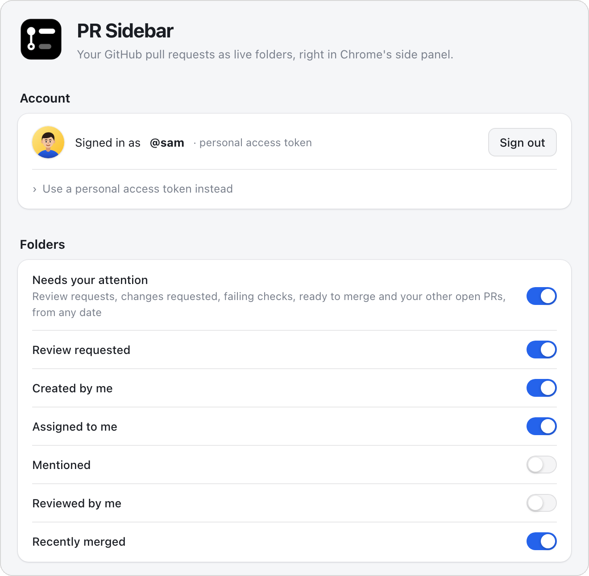

# PR Sidebar

Your GitHub pull requests as Arc-style live folders, in Chrome's side panel.

Sample data: the repositories are real projects, the pull requests and authors are made up.

## Why

I work on around 20 pull requests a day, spread across many different repositories. GitHub shows them one repository or one notification at a time, so things slip through. A review request from two weeks ago sinks under newer activity. A PR fails its checks overnight and nobody notices. An approved PR sits unmerged for days.

PR Sidebar puts all of it in one list that stays open next to whatever you're working on. Anything waiting on you goes to the top of **Needs your attention**, however old it is, so a request you missed last week is just as visible as one from five minutes ago. Everything else is one click away, and opens in its own tab group instead of scattering across your tabs.

## What it does

- **Needs your attention:** one folder for everything waiting on you, from any date: review requests, your PRs with changes requested or failing checks, PRs ready to merge, PRs assigned to you, and your other open PRs.
- **Live folders:** Review requested, Created by me, Assigned to me, Mentioned, Reviewed by me, Recently merged, plus custom folders from any GitHub search (`repo:acme/api is:open`, `team-review-requested:acme/backend`, …).
- **At a glance:** CI status on every PR, review labels, unread dots for new PRs, and an unread count on the toolbar icon.
- **Its own space:** clicking a PR opens it in a "Pull Requests" tab group, or switches to it if it's already open. The sidebar's accent follows that tab group's colour.
- **Filters:** a time range (default: last week), quick filters for Review, Changes, Failing and Ready, search, group by repository, hide drafts, and pinned PRs.
- **Notifications** for new review requests, and for your PRs that get changes requested or start failing checks.
- Refreshes every 2 minutes by default.

Keyboard: `Alt+Shift+P` opens the sidebar, `/` searches, `↑`/`↓` move, `Enter` opens, `p` pins, `u` toggles read, `R` refreshes.

### Settings

Choose your folders, add custom ones from any GitHub search, and set the refresh interval, tab group colour and notifications.

## Install (unpacked)

1. Download `pr-sidebar-v<version>.zip` from the latest [release](../../releases/latest) and unzip it, or clone this repo.
2. Open `chrome://extensions`, turn on **Developer mode**, click **Load unpacked** and choose the unzipped folder.
3. Pin PR Sidebar, click its icon, and click **Sign in with GitHub**. Or paste a personal access token in Settings (classic token with the `repo` and `read:org` scopes).

After changing `manifest.json`, click the reload icon on the extension's card. Changes to the sidebar's HTML, CSS or JS show up the next time you open the panel.

### Organization PRs missing?

If your org restricts third-party apps, its PRs are hidden until an owner approves PR Sidebar. The sidebar shows a banner with a link to request access. A personal access token works without that approval.

## Builds and releases

Every push to `main` runs [Pack extension](.github/workflows/pack.yml). It syntax-checks the scripts, verifies that every file the manifest and pages reference exists, and zips only what Chrome needs into `pr-sidebar-v<version>.zip` (attached to the run).

To publish a release, bump `version` in `manifest.json` and push. The workflow creates a GitHub Release `v<version>` with the zip attached; that zip is also what you upload to the Chrome Web Store. Pushes that don't change the version only produce the run artifact.

Build the same zip locally with `./scripts/pack.sh` (output in `dist/`).

## Project layout

| Path | What it is |
| --- | --- |
| `manifest.json` | Extension manifest (MV3) |
| `background.js` | Background refresh, toolbar badge, notifications |
| `github.js` | GitHub API, sign-in (OAuth device flow), folders, attention ranking |
| `sidepanel.*` | The sidebar UI |
| `options.*` | Settings page |
| `icons/` | Toolbar icons; `icon.svg` (48px and up) and `icon-small.svg` (16 and 32px) are the sources |
| `design/` | Store tile, one-colour marks, GitHub app logo |
| `docs/screenshots/` | README screenshots (sample data) |
| `STORE_LISTING.md` | Chrome Web Store copy and permission justifications |
| `scripts/pack.sh`, `.github/workflows/pack.yml` | Packaging and releases |

## Privacy

PR Sidebar talks only to GitHub. Your token and PR data stay in your browser's extension storage.
