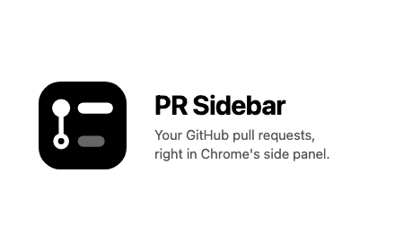

# PR Sidebar

Your GitHub pull requests as Arc-style live folders, in Chrome's side panel.

## What it does

- **Needs your attention:** one folder for everything waiting on you, from any date: review requests, your PRs with changes requested or failing checks, PRs ready to merge, PRs assigned to you, and your other open PRs.
- **Live folders:** Review requested, Created by me, Assigned to me, Mentioned, Reviewed by me, Recently merged, plus custom folders from any GitHub search (`repo:acme/api is:open`, `team-review-requested:acme/backend`, …).
- **At a glance:** CI status on every PR, review labels, unread dots for new PRs, and an unread count on the toolbar icon.
- **Its own space:** clicking a PR opens it in a "Pull Requests" tab group, or switches to it if it's already open. The sidebar's accent follows that tab group's colour.
- **Filters:** a time range (default: last week), quick filters for Review, Changes, Failing and Ready, search, group by repository, hide drafts, and pinned PRs.
- **Notifications** for new review requests, and for your PRs that get changes requested or start failing checks.
- Refreshes every 2 minutes by default.

Keyboard: `Alt+Shift+P` opens the sidebar, `/` searches, `↑`/`↓` move, `Enter` opens, `p` pins, `u` toggles read, `R` refreshes.

## Install (unpacked)

1. Open `chrome://extensions` and turn on **Developer mode**.
2. Click **Load unpacked** and choose this folder.
3. Pin PR Sidebar, click its icon, and click **Sign in with GitHub**. Or paste a personal access token in Settings (classic token with the `repo` and `read:org` scopes).

After changing `manifest.json`, click the reload icon on the extension's card. Changes to the sidebar's HTML, CSS or JS show up the next time you open the panel.

### Organization PRs missing?

If your org restricts third-party apps, its PRs are hidden until an owner approves PR Sidebar. The sidebar shows a banner with a link to request access. A personal access token works without that approval.

## Project layout

| Path | What it is |
| --- | --- |
| `manifest.json` | Extension manifest (MV3) |
| `background.js` | Background refresh, toolbar badge, notifications |
| `github.js` | GitHub API, sign-in (OAuth device flow), folders, attention ranking |
| `sidepanel.*` | The sidebar UI |
| `options.*` | Settings page |
| `icons/` | Toolbar icons; `icon.svg` (48px and up) and `icon-small.svg` (16 and 32px) are the sources |
| `design/` | Store tile, one-colour marks, GitHub app logo |
| `STORE_LISTING.md` | Chrome Web Store copy and permission justifications |

## Privacy

PR Sidebar talks only to GitHub. Your token and PR data stay in your browser's extension storage.
